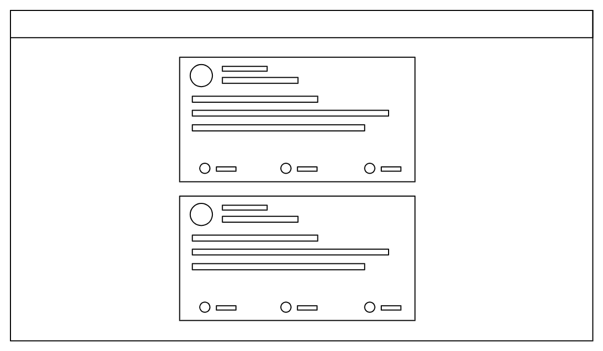
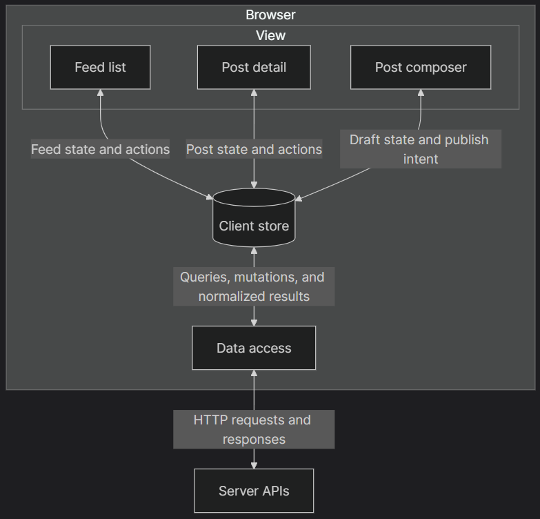
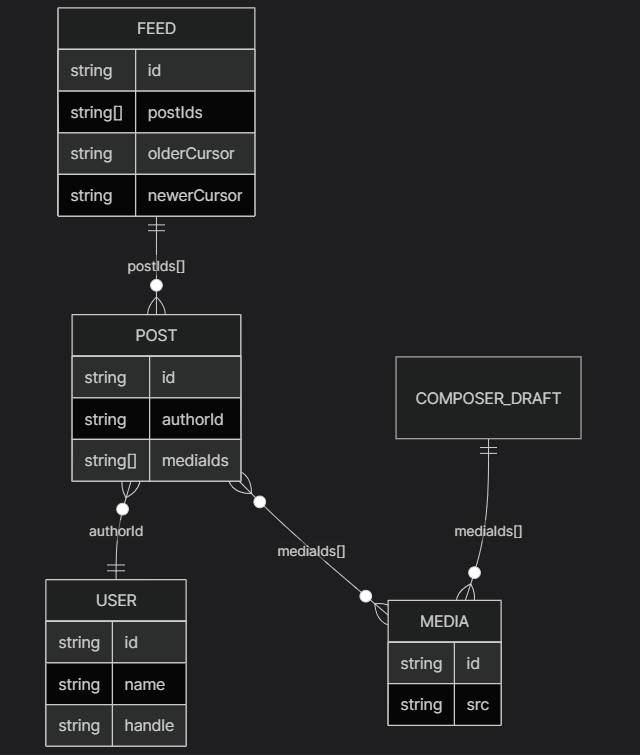
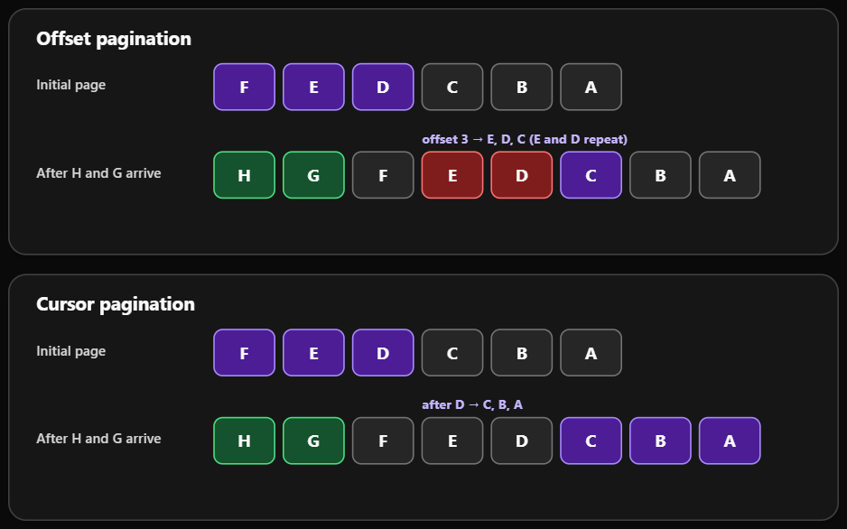

# News Feed 新闻信息流



## Architecture / high-level design

### Rendering approach 渲染方式

- [Client-side rendering (CSR)](https://developer.mozilla.org/en-US/docs/Glossary/CSR)

  The feed is highly interactive, heavily personalized, and benefits from keeping state alive in the browser over a long-lived session.

  Feed 交互性极强、高度个性化，并且得益于在长期存在的 session 中让 state 在浏览器里一直保持有效。

- Hybrid rendering

  Hybrid rendering combines SSR and CSR. The initial page is rendered on the server for speed, while dynamic updates happen on the client after hydration.

  Hybrid rendering 结合了 SSR 和 CSR。为了加快速度，初始页面在服务器端渲染，而在 hydration 之后，动态更新则在客户端进行。

### Navigation approach 导航方式

[Single-page application (SPA)](https://developer.mozilla.org/en-US/docs/Glossary/SPA)

The biggest reason is shared client state.

主要原因是 client state 共享。

### Architecture layers 架构层



- View: React
- Store: Redux, Zustand
- Data access: TanStack Query

## Data model / entities

Normalized store structure 规范化存储结构

每个唯一的 entity 只存储一次，彼此之间的关系用 ID 表示，而不是嵌套的副本。这借鉴了关系型数据库的设计方式，只不过是应用在浏览器内部。



- A change to `usersById[id]` is reflected everywhere that entity is referenced by ID, reactions and shares update one canonical `Post` record, and loading more posts becomes a merge of IDs and entities instead of an append of nested blobs.

  对 `usersById[id]` 的修改会同步体现在所有通过 ID 引用该 entity 的地方；互动和分享只需更新唯一一条 Post 记录；加载更多帖子也变成了合并 ID 和 entity，而不是追加嵌套的数据块。

- Either the server returns a compact normalized payload, or the data access layer normalizes nested responses before writing them into the store. API simplicity favors the nested-then-client-normalize shape;

  要么由服务器直接返回紧凑的 normalized payload，要么由 Data access 在写入 store 之前对嵌套响应进行 normalize。若追求 API 的简洁，更适合采用"先返回嵌套数据、再由客户端 normalize"的方式；

## Interface definition (API)

The client should not send a userId parameter as the source of truth for identity; identity should come from session cookies or the product's authentication token mechanism.

客户端不应把 userId 参数当作身份的可信依据发送给服务器；身份信息应当来自 session cookie 或产品本身的 authentication token 机制。

### Pagination approaches

Cursor-based pagination uses a unique identifier such as a post ID or timestamp as a cursor that marks the boundary between pages. Instead of asking for "the next 10 results after offset 20", the client requests "the next 10 results after post ID X".

Cursor-based pagination 用一个唯一标识（例如 post ID 或时间戳）作为 cursor，标记页与页之间的分界。客户端不再请求"offset 20 之后的 10 条结果"，而是请求"post ID X 之后的 10 条结果"。



Cursor-based pagination is more stable and efficient because it does not depend on the dataset's size or ordering at query time. It works well in environments where data is frequently updated, such as a news feed where new posts appear constantly and older posts can be deleted, re-ranked, or refreshed.

Cursor-based pagination 更加稳定、高效，因为它不依赖于查询时数据集的大小或排序。它非常适合数据频繁更新的场景，例如 news feed：新帖子不断出现，而旧帖子可能被删除、重新排序或刷新。

```js
router.get("/posts", async (req, res) => {
  const limit = Number(req.query.limit)
  const { cursorCreatedAt, cursorId } = req.query

  const rows = await Post.findAll({
    where: {
      [Op.or]: [
        { createdAt: { [Op.lt]: cursorCreatedAt } },
        { createdAt: cursorCreatedAt, id: { [Op.lt]: cursorId } },
      ],
    },
    order: [
      ["createdAt", "DESC"],
      ["id", "DESC"],
    ],
    limit: limit + 1,
  })

  const hasMore = rows.length > limit
  const items = rows.slice(0, limit)
  const last = items.at(-1)

  res.json({
    items,
    nextCursor: hasMore ? { createdAt: last.createdAt, id: last.id } : null,
  })
})
```

Offset pagination is mainly a better fit for relatively static, page-numbered lists such as classic search results or admin tables.

Offset pagination 主要更适合相对静态、带页码的列表，比如传统的搜索结果或后台管理表格。

### HTTP caching, deduplication, and idempotency

Personalized feed responses should be marked `private`.

个性化的 feed 响应应当标记为 private。

```http
Cache-Control: private, no-cache
ETag: "feed-u123-v8841"
```

[Etag: Caching of unchanged resources](https://developer.mozilla.org/en-US/docs/Web/HTTP/Reference/Headers/ETag#caching_of_unchanged_resources)

In-flight coalescing and `AbortController` are appropriate for identical or superseded reads.

In-flight coalescing (在途请求合并) 和 `AbortController` 适用于完全相同或已被新请求取代的读请求。

```ts
const usePost = (id: string) =>
  useQuery({
    queryKey: ["post", id],
    queryFn: () => fetch(`/api/posts/${id}`).then((r) => r.json()),
  })
```

```ts
const useSearch = (q: string) =>
  useQuery({
    queryKey: ["search", q],
    queryFn: ({ signal }) =>
      fetch(`/api/search?q=${encodeURIComponent(q)}`, { signal }).then((r) =>
        r.json(),
      ),
    placeholderData: keepPreviousData,
  })
```

Reactions are distinct mutations: serialize them per post or attach a client sequence/version, ignore stale responses, and reconcile from the latest authoritative server version.

Reactions 是各自独立的 mutation：要么按 post 进行串行化，要么附带客户端的 sequence/version，忽略过期的响应，并以服务器最新的权威版本为准进行 reconcile(调和)。

[Mutation Scopes](https://tanstack.com/query/latest/docs/framework/react/guides/mutations#mutation-scopes)

```ts
const useReact = (postId: string) =>
  useMutation({
    mutationKey: ["react", postId],
    scope: { id: `react:${postId}` },
    mutationFn: (v: { emoji: string; seq: number }) =>
      fetch(`/api/posts/${postId}/reactions`, {
        method: "POST",
        body: JSON.stringify(v),
      }).then((r) => r.json()),
  })
```

Writes need idempotency keys. Post creation, reactions, and shares can be retried by the client, by the service worker after reconnect, or by a proxy on a flaky network, so the server should treat a key seen twice as the same write, returning the original result instead of creating a duplicate post. Generate the key on the client (e.g. a UUID attached to the request body or an `Idempotency-Key` header) at the moment the user submits, not at send time, so retries carry the original key.

写操作需要幂等键（idempotency key）。 创建帖子、点赞/表情回应、分享这些请求，都可能被重试：可能是客户端自己重试，可能是 Service Worker 在网络恢复后重发，也可能是网络不稳定时代理服务器重发。所以服务器在第二次收到同一个键时，应该把它当成同一次写入，直接返回第一次的结果，而不是再建一条重复的帖子。这个键要在客户端生成（比如一个 UUID，放进请求体或 `Idempotency-Key` 请求头），而且要在用户点击提交的那一刻生成，不能等到发送时才生成。这样每次重试带的都是最初那个键。

```js
const store = new Map()

const idempotency = (req, res, next) => {
  const key = req.get("Idempotency-Key")

  const saved = store.get(key)
  if (saved) {
    if (!saved.status)
      return res.status(409).json({ error: "Request in progress" })
    return res.status(saved.status).json(saved.body)
  }

  store.set(key, {})
  const json = res.json.bind(res)
  res.json = (body) => {
    store.set(key, { status: res.statusCode, body })
    return json(body)
  }
  next()
}
```
